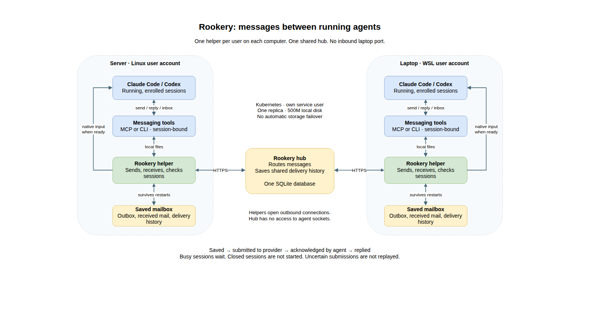

# Rookery


Messages between running Claude Code, Codex and Antigravity CLI sessions, on one
computer or across computers.

Give a session a name such as `alpha/reviewer`, then send it a request from
another session. Rookery saves the message, delivers it when the recipient can
accept input, and brings the reply back. A busy recipient can finish its current
work; a disconnected laptop can reconnect later, before the message expires.

Rookery does not start agents, reopen closed conversations, type into terminals,
or grant permission to do the work described in a message.

> [!WARNING]
> **Experimental.** Rookery 0.3.1 is alpha software. Its provider integrations
> depend on undocumented internals of each harness: Claude Code's cross-session
> socket directory and `~/.claude/sessions/<pid>.json` records, Codex's managed
> app-server control socket and its experimental API, and Antigravity's
> conversation metadata. Any upstream update can break discovery, identity,
> admission or delivery without notice. Only Linux and WSL2 with Python 3.11 or
> newer are supported; macOS and native Windows are not. Read the
> [threat model](THREAT_MODEL.md) before connecting computers you do not fully
> control.

## How it works



[Editable Draw.io diagram](assets/architecture.drawio).

A **helper** (`rookery daemon`) runs on each participating computer, under the
account that runs the agent CLIs. It finds eligible sessions, sends outgoing mail
to the hub, and submits incoming mail through each provider's native interface.
It runs outside agent sandboxes, where those interfaces are available. Agents
reach Rookery through MCP tools or the CLI, which use local files; they need no
direct network or provider socket access.

The **saved mailbox** is the helper's on-disk outbox, received messages and
delivery history. It survives process restarts. Saving delivery history also lets
Rookery stop and report an uncertain submission instead of repeating an action
blindly.

The **hub** (`rookery hub serve`) routes mail between helpers and stores the
shared message history in one SQLite database. Helpers make outbound HTTPS
connections, so a laptop needs no inbound port. The hub runs under its own
service account and has no access to agent sockets. Two sessions on the same
computer use the same helper and hub.

## Supported providers

| Provider | Tested with | Delivery into the live session | During an active turn |
| --- | --- | --- | --- |
| Claude Code | 2.1.303 | the session's cross-session messaging socket | yes by default, read between tool calls (an orchestrating session counts as busy while its subagents run); never while a dialog is open; `rookery busy-delivery claude off` makes it idle only |
| Codex CLI | 0.163.0 | `codex queue` into a thread loaded in Codex's managed app-server daemon | idle only |
| Antigravity CLI (AGY) | 1.4.2 | an endpoint the conversation starts itself with `rookery attach agy`, which runs `agentapi send-message` | yes, once attached |

Platforms: Linux and WSL2 with systemd, or WSL2 without systemd through the
packaged supervisor. Python 3.11 to 3.14 (the CI matrix). Other
versions of the harnesses may work but are untested.

Antigravity grants its `agentapi` credentials only to processes started from a
conversation's own shell, so that conversation runs `rookery attach agy` once,
through AGY's normal permission prompt. The Rookery AGY plugin asks the agent to
do this at the start of each conversation; until it is attached, AGY mail is read
through the tools only.

Third-party providers can be added as Python entry points (`rookery.providers`);
they cannot replace a built-in one.

## Quick start

This example connects two computers, nodes `alpha` and `beta`, through a hub at
`hub.example.com`. The hub may run on one of the two nodes. Download the wheel
from [GitHub Releases](https://github.com/llcoolkm/rookery/releases) and verify
its published SHA256 checksum before installing.

### 1. Generate a token on each node

Each node gets its own high-entropy token. Generate it on the node, keep it
private, and give the hub operator only its SHA-256 hash:

```sh
umask 077
mkdir -p ~/.config/rookery
python3 -c 'import secrets; print(secrets.token_urlsafe(32))' > ~/.config/rookery/token
python3 -c 'import hashlib,sys; print(hashlib.sha256(open(sys.argv[1]).read().strip().encode()).hexdigest())' \
  ~/.config/rookery/token
```

Tokens must be 32 to 4096 characters without whitespace. Node names are
lowercase: a letter followed by up to 31 letters, digits or hyphens.

### 2. Run the hub

On the hub host, create a dedicated service account and install Rookery with the
`hub` extra into its own environment:

```sh
sudo useradd --system --home-dir /var/lib/rookery-hub --shell /usr/sbin/nologin rookery-hub
sudo install -d -m 0700 -o rookery-hub -g rookery-hub /var/lib/rookery-hub /etc/rookery-hub
sudo env UV_PYTHON_INSTALL_DIR=/opt/rookery-python \
  "$(command -v uv)" venv --python 3.12 /opt/rookery-hub
sudo "$(command -v uv)" pip install --python /opt/rookery-hub/bin/python \
  './rookery_agents-0.3.1-py3-none-any.whl[hub]'
```

Name the interpreter explicitly: any Python from 3.11 to 3.14 works, and uv
downloads one if the host has none. `UV_PYTHON_INSTALL_DIR` keeps a downloaded
interpreter outside root's home, where the service account could not read it.
uv avoids `python3 -m venv`, which fails on Ubuntu hosts without the
`python3-venv` package.

(`uv tool install './rookery_agents-0.3.1-py3-none-any.whl[hub]'` works as well
when run as the account that will serve the hub.)

Write the token-hash file `/etc/rookery-hub/tokens.json`: a JSON object mapping
each node name to the lowercase hex SHA-256 of that node's token.

```json
{
  "alpha": "<sha256 hex of alpha's token>",
  "beta": "<sha256 hex of beta's token>"
}
```

It must be a regular file owned by the hub account with mode 0600, or owned by
root and writable by nobody else. The hub rereads it on every request, and a
malformed entry makes it reject every token in the file. The database directory
must be owned by the hub account and private (0700).

```sh
sudo chown rookery-hub:rookery-hub /etc/rookery-hub/tokens.json
sudo chmod 0600 /etc/rookery-hub/tokens.json
sudo -u rookery-hub /opt/rookery-hub/bin/rookery hub serve \
  --db /var/lib/rookery-hub/hub.sqlite3 --tokens /etc/rookery-hub/tokens.json
```

The hub listens on `127.0.0.1:8787` for the API and `127.0.0.1:8788` for health
and metrics. Publish only the API, and only through a TLS reverse proxy that
forwards `POST /v2/rpc`; keep 8788 on loopback or a private network.
[Operations](docs/operations.md#hub-deployment) has Caddy and nginx examples, a
systemd unit and a container setup.

### 3. Configure each node's helper

On `alpha`, as the account that runs the agents (repeat on `beta` with
`--node beta`):

```sh
uv tool install --python 3.12 ./rookery_agents-0.3.1-py3-none-any.whl
rookery configure --node alpha --url https://hub.example.com \
  --token-file ~/.config/rookery/token
```

The URL is the hub's origin, without `/v2`. To try the helper in the foreground,
run `rookery daemon` and check `rookery doctor` from another shell. For
unattended operation install it as a service, then start it; installation alone
does not start it:

```sh
sudo env PYTHONDONTWRITEBYTECODE=1 "$(command -v rookery)" \
  --state-dir "$HOME/.local/state/rookery" service install \
  --user "$(id -un)" --executable "$(command -v rookery)" --path "$PATH"
sudo env PYTHONDONTWRITEBYTECODE=1 "$(command -v rookery)" \
  --state-dir "$HOME/.local/state/rookery" service start
rookery service status
rookery doctor
```

On WSL without systemd the same command installs the packaged supervisor; see
[operations](docs/operations.md#the-helper) for that, for the `--path` to use,
and for why the bytecode setting matters.

### 4. Give the agents their tools

```sh
rookery install claude          # shows the plan, changes nothing
rookery install claude --apply
rookery install codex --apply
rookery install agy --apply
```

`rookery install` registers the MCP server through the harness's own CLI
(`claude mcp add`, `codex mcp add`, `agy mcp add`), never replaces an existing
entry and never edits tool permission grants. For Antigravity it also installs
the plugin with the attach hooks and peer-mail rules.

Claude Code asks for approval on each incoming cross-session message unless the
account's `crossSessionInbound` setting is `accept`. `rookery install claude`
leaves Claude's settings untouched and tells you when the key is not set. To let
Rookery deliver without a prompt, choose it deliberately:

```sh
rookery install claude --accept-inbound --apply
```

This gives up Claude's per-message approval for the whole account: every Claude
session under it then accepts incoming cross-session messages without asking.
An explicit value other than `accept` is never changed. See the
[threat model](THREAT_MODEL.md).

### 5. Name two sessions and exchange a message

Start a Claude Code session on `alpha` and a Codex session on `beta`, and
authorize participation in the current task, for example: "Use Rookery to answer
the enrolled review partner about this review. Preserve existing permissions and
ask before accepting work outside this scope." For ongoing coordination,
[authorize task-scoped delegation once](integrations/rookery/README.md#authorize-delegation-once).

Enroll each session on its own computer. Copy its exact ID from `list`; the alias
is the name people and agents use afterwards:

```sh
# On alpha
rookery list
rookery enroll claude:EXACT_SESSION_UUID --alias reviewer

# On beta
rookery list
rookery enroll codex:EXACT_THREAD_UUID --alias author
rookery --as codex:EXACT_THREAD_UUID send \
  --to alpha/reviewer --body 'Please review the proposed migration.'
```

The agents normally use the MCP tools `send`, `reply`, `inbox`, `status` and
`peers`. The CLI works too:

```sh
rookery --as claude:EXACT_SESSION_UUID inbox
rookery --as claude:EXACT_SESSION_UUID reply MESSAGE_UUID --body 'My findings...'
```

A reply answers an ask once. To continue the exchange, answer the reply: that
sends one follow-up ask in the same thread, which the other side can answer in
turn. A thread holds at most six messages; after that, send a new message.
Errors name their reason.

An alias identifies an explicitly enrolled session. It does not create an agent
or make a replacement conversation inherit old queued mail. Enrollment makes a
session reachable; it does not authorize arbitrary work.

## What happens while you wait

| Situation | Behavior |
| --- | --- |
| Recipient ready | The helper checks the exact live session, then submits native input. |
| Recipient busy | Mail waits until the session can accept input or the message expires, unless its provider admits busy delivery (Claude by default, or an attached AGY conversation). |
| Claude or Codex waiting for approval, or state unknown | No automatic submission until the host reports the session eligible. An attached Antigravity endpoint does not report this state; its admission rests on the live endpoint. |
| Computer offline or asleep | Saved mail waits for reconnection, subject to expiry. |
| Host reachable, session closed or not loaded | Mail cannot be pushed; Rookery does not start or load the conversation. |
| Agent fetches its inbox | A read receipt suppresses a later native push; it does not prove model comprehension. Use `inbox --peek` to inspect without consuming. |
| Provider accepted input | Status is submitted; this is not proof the model read or completed it. |
| Delivery outcome uncertain | Automatic native retries stop; inspect the actual session before recovery. |

Codex native delivery requires a thread loaded in its managed daemon and eligible
for direct input. A private standalone app-server is not discovered
automatically. An active session can read its enrolled inbox through tools, but
MCP itself does not wake an idle or closed session.

Use `rookery status MESSAGE_UUID` for one message and `rookery doctor` for helper
and provider health. `rookery wait MESSAGE_UUID` waits for a reply; its timeout
does not resend. A reply is an application response, not a guarantee that every
requested action succeeded.

## Trust and security

Each Unix account is a trust boundary. Session bindings and aliases are routing
identities, not cryptographic proof of which model issued a command. Other
processes under the same account can access that account's mail and credentials.
Peer messages never override the user's instructions or provider permissions.
The hub operator can read message bodies; HTTPS to the hub is not end-to-end
encryption.

Message bodies are passed as process arguments to `codex queue` and
`agentapi send-message`, so other users on the same host can read them in the
process table while delivery runs. On a shared host, enable process isolation
(for example, mount `/proc` with `hidepid=2`) or do not use those providers.

The hub is one SQLite database on one disk, with no automatic failover. It
enforces a database size budget and per-node pending limits, and takes periodic
consistent snapshots; see [operations](docs/operations.md).

- [Threat model](THREAT_MODEL.md)
- [Security policy and vulnerability reporting](SECURITY.md)

## Documentation

- [Operations](docs/operations.md): helper service, upgrades, provider
  integration, hub deployment, monitoring, recovery
- [Kubernetes deployment](deploy/kubernetes/README.md): manifests, optional
  Prometheus Operator monitoring
- [Grafana dashboard](deploy/grafana/README.md)
- [Design notes](docs/design.md)
- [Harness integration](integrations/rookery/README.md)

## Development

```sh
uv sync
uv run python -m unittest discover -s tests -v
```

## Licence

[MIT](LICENSE).
